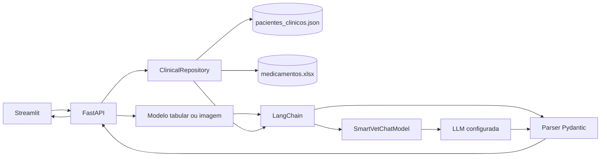

# Fase 3 — LangChain e contexto clínico estruturado

## Objetivo

A fase 3 integra o LangChain a uma LLM configurável e contextualiza as interpretações dos modelos do Smart VET com registros clínicos atualizados do paciente.

A classificação continua sendo produzida pelos modelos tabular e de imagem. A LLM não substitui esses modelos, não fecha diagnóstico e não cria prescrições. Ela recebe o resultado da inferência e, quando autorizado, o registro estruturado do paciente para produzir uma explicação clínica em formato validado.

## Arquitetura



## Base estruturada

Os dados de execução ficam em `src/back-end/fastapi/data` para serem incluídos no contexto Docker do backend.

- `pacientes_clinicos.json`: 50 prontuários sintéticos com identificação, sinais vitais, histórico, protocolo, laudo, diferenciais, prescrição e acompanhamento.
- `medicamentos.xlsx`: 37 medicamentos com faixas de dose, vias, contraindicações e alertas.
- `src/tests/fixtures/benchmark_qa_gemma.json`: 50 casos de avaliação, separados dos dados de produção.

O `ClinicalRepository` valida a estrutura na inicialização, indexa pacientes por ID, relaciona medicamentos de forma determinística e calcula uma versão da base por SHA-256. Quando `CLINICAL_DATA_RELOAD=true`, mudanças locais nos arquivos são percebidas sem reiniciar o processo.

Os PDFs derivados não são necessários em execução porque repetem o conteúdo do JSON. A recuperação por ID evita o risco de uma busca vetorial selecionar o prontuário de outro paciente.

## Integração LangChain

`SmartVetChatModel` implementa `BaseChatModel` e adapta provedores que exponham uma API compatível com `chat/completions`. O pipeline utiliza:

1. `RunnableLambda` para consultar o paciente na base estruturada;
2. `ChatPromptTemplate` para separar instruções, resultado do modelo e dados clínicos;
3. `SmartVetChatModel` para chamar a LLM configurada;
4. `PydanticOutputParser` para validar a resposta;
5. fallback entre provedores e interpretação local baseada em regras.

O prompt trata prontuário e resultado como dados, não como instruções, e proíbe diagnóstico definitivo, alteração de prescrição e criação de doses.

## Configuração

```env
LLM_PROVIDER=gemini
LLM_API_KEY=
LLM_BASE_URL=https://generativelanguage.googleapis.com/v1beta/openai
LLM_MODEL=gemini-3.6-flash
LLM_JSON_MODE=true

LLM_FALLBACK_1_PROVIDER=huggingface
LLM_FALLBACK_1_API_KEY=
LLM_FALLBACK_1_BASE_URL=https://router.huggingface.co/v1
LLM_FALLBACK_1_MODEL=Qwen/Qwen3-4B-Instruct-2507

LLM_MAX_RETRIES=2
LLM_RETRY_BACKOFF_SECONDS=1.0

CLINICAL_DATA_DIR=data
CLINICAL_DATA_RELOAD=true
ALLOW_REMOTE_CLINICAL_CONTEXT=true
```

`ALLOW_REMOTE_CLINICAL_CONTEXT` permanece habilitado por padrão porque a base fornecida contém registros sintéticos. Com a opção habilitada, a LLM recebe o prontuário do paciente selecionado. Defina a opção como `false` antes de usar dados reais, a menos que privacidade, consentimento e contrato do provedor tenham sido revisados.

Falhas transitórias dos provedores, como HTTP `429`, `500`, `502`, `503` e `504`, são repetidas automaticamente com espera progressiva. A quantidade de novas tentativas e a espera inicial são configuradas por `LLM_MAX_RETRIES` e `LLM_RETRY_BACKOFF_SECONDS`.

## API

- `GET /health`: inclui quantidade e versão dos dados clínicos.
- `GET /patients`: retorna somente ID, nome, espécie e raça; exige `X-API-Key` quando configurada.
- `POST /predict/condition`: aceita `patient_id` opcional no JSON.
- `POST /predict/image`: aceita `patient_id` opcional no formulário multipart.

As respostas incluem `clinical_context` somente com metadados: paciente usado, versão do protocolo, versão da base e IDs dos medicamentos relacionados. O prontuário completo não é devolvido.

## Segurança

- Chaves permanecem em `.env` ou no gerenciador de segredos do Render.
- Prontuários, prompts e tokens não são registrados em logs.
- A listagem de pacientes e os diagnósticos respeitam a autenticação existente por `X-API-Key`.
- O envio de contexto clínico remoto pode ser desabilitado com `ALLOW_REMOTE_CLINICAL_CONTEXT=false` e deve ser revisto antes do uso de dados reais.
- Uma falha da LLM não interrompe a triagem: a API retorna a interpretação local.

## Testes

Os testes unitários validam carregamento e atualização da base, IDs, cobertura do benchmark, associação de medicamentos, bloqueio de contexto remoto, parsing estruturado e fallback. Os testes de integração existentes também verificam os novos contratos de `/health`, `/patients` e os metadados clínicos nas duas modalidades de diagnóstico.

```bash
cd src/back-end/fastapi
.venv/bin/python -m pytest ../../tests/test_clinical_repository.py ../../tests/test_langchain_service.py -q
```
